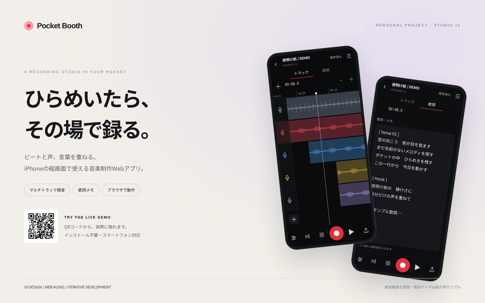

# Pocket Booth — STUDIO 11



iPhoneの縦画面で、ビートに声を重ねる音楽制作Webアプリ。生成AIの実装支援も活用した個人制作・開発中のプロトタイプです。

**[公開デモ](https://pocket-booth.b7684wyb9p.chatgpt.site/)**

## できること

- 音声ファイル、対応するMP4・MOVの音声読み込み
- ビートを聴きながらのボーカル録音・マルチトラック再生
- 長押しでのクリップ移動・タイミング補正・2本指ズーム
- 曲ごとの歌詞メモ、IndexedDBへの保存、JSONバックアップ
- 48kHz / 24bit WAVミックス書き出し
- ブラウザが公開する範囲での入力マイク選択

## ローカルで動かす

ビルド不要。Python 3を使用する場合：

```sh
python3 -m http.server 4173 --bind 127.0.0.1 --directory dist
```

PCで http://localhost:4173 を開きます。iPhoneでマイクを利用する場合はHTTPSの公開先を使用してください。

## テスト

Node.js 20以降：

```sh
npm test
```

`tests/browser-*.mjs` はPlaywrightとChromiumを使う追加のブラウザ検証です。必要なfixtureや環境変数は各スクリプトを参照してください。

## Cloudflareへの配置

`wrangler.jsonc` に静的ファイル配信用の設定を同梱しています。自分のCloudflareアカウントでログイン後：

```sh
npx wrangler deploy
```

ソースは本リポジトリで公開しています。公開デモはSitesで配信しています。Cloudflareへの直接公開用の設定も同梱していますが、アカウント側のWorkers権限が必要です。

## 技術

HTML / CSS / JavaScript ES Modules / Web Audio API / AudioWorklet / MediaDevices API / IndexedDB / Web App Manifest

## 保存・制約

音源・録音・歌詞は利用者のブラウザ内に保存され、端末間でのクラウド同期はありません。サイトデータを消すと失われるため、大切な曲はバックアップしてください。音質、入力切り替え、遅延は端末・ブラウザ・イヤホンに依存します。特にBluetoothマイクは通話用の音質になる場合があります。

この公開用スナップショットには個人の録音・歌詞・認証情報・内部ホスティングIDは含めていません。ライセンスによる追加の利用許諾は指定していません。

## ポートフォリオ素材

[紹介文](docs/portfolio/description-ja.md) / [編集画面](docs/portfolio/screenshots/editor.png) / [歌詞画面](docs/portfolio/screenshots/lyrics.png) / [プロジェクト一覧](docs/portfolio/screenshots/library.png) / [QRコード](docs/portfolio/qr-code.png)

紹介画像は実装画面を表示し、デモ音源・サンプル歌詞を入れて撮影しています。個人の制作データは使用していません。
